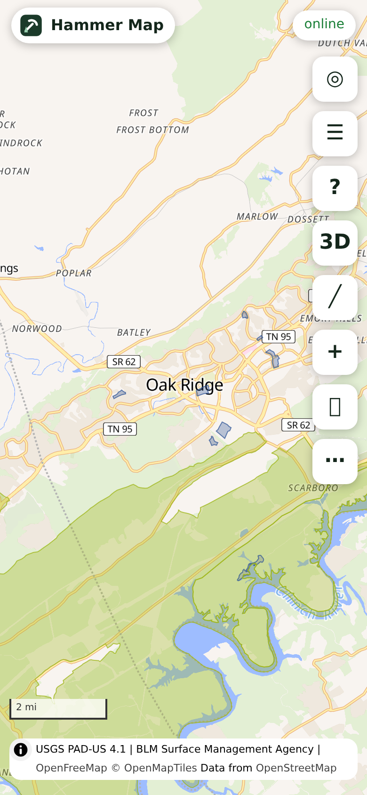

# Hammer Map

A fieldwork web app for collecting rocks and minerals: mark spots on a phone, see who runs the land and whether
collecting is allowed, with maps that work when there is no signal. Plain HTML, CSS and JavaScript (no build step,
no server of our own), installable as a progressive web app from any static host.

**Open it:** https://channerma.github.io/hammer_map/ (served by GitHub Pages from this repository's `main`).
On a phone, open that address and choose "Add to Home Screen" to install it.

## What it does

| Feature | Screenshot |
|---|---|
| **Map.** MapLibre GL JS 5.24.0 on the GPU. Basemaps: OpenFreeMap Liberty (vector tiles, default), USGS Topo, USGS Imagery, USGS Imagery + Topo (raster). Switching basemaps toggles layer visibility inside one style, nothing is rebuilt. Scale bar in miles and feet. More basemaps from the HCMGIS list, online only: nine from Esri (imagery, topographic, street and others), three from CARTO with a free key, F4 Map and HCMC OneMap, plus an Esri place-name overlay (see "More basemaps"). | [01](screenshots/01-map-ownership-oak-ridge.png), [10](screenshots/10-esri-imagery-place-names.png), [11](screenshots/11-basemap-picker.png) |
| **Land ownership.** USGS PAD-US 4.1 manager type as vector tiles nationwide (federal, state, local, tribal, private conservation, private, district, unknown), plus federal agency fills (BLM, Forest Service, NPS, FWS, Reclamation, DoD, BIA, DOE) from the West-US Surface Management Agency vector tiles; a national BLM SMA raster is the opt-in fallback. Translucent fills with a legend. | [01](screenshots/01-map-ownership-oak-ridge.png), [02](screenshots/02-map-ownership-claims-tonopah.png) |
| **Mining claims.** BLM MLRS claims from zoom 11: open claims (purple outline, light fill; stacked claims darken) and claims closed within the past year (dashed). Tap for the case name, serial number, claim type, disposition, acres and date, with a link to MLRS for the claimant. | [02](screenshots/02-map-ownership-claims-tonopah.png) |
| **Can I collect here?** Tap any place or pin: the land manager and unit (PAD-US and BLM SMA at the point), public-access and GAP codes, any claim there, then the collecting rules for that manager from `rules.json` with their sources. | [03](screenshots/03-can-i-collect-here.png), [03b](screenshots/03b-can-i-collect-here-tennessee.png) |
| **Records.** USGS MRDS historic mining records (brown) and Paleobiology Database fossil occurrences (blue) as clustered symbol layers, fetched only for the view from zoom 9. Clubs: none are built in; import your own list as GPX/KML with type `club` (purple). | [02b](screenshots/02b-records-tonopah.png) |
| **Live conditions.** NIFC wildfire perimeters, NOHRSC snow depth and NWS 24-hour rain, each with a "live" badge and the time fetched; fetched only when switched on and expiring after 30 min / 6 h / 1 h. | [02c](screenshots/02c-live-fire-west.png) |
| **Offline maps.** Use the current view or draw a box, choose the max zoom and contents, see a size estimate from measured tile sizes, download into the browser cache with a progress bar; saved areas are listed with size, date and delete. | [06](screenshots/06-offline-download.png), [07](screenshots/07-offline-reload.png) |
| **3D terrain.** The terrain source (AWS terrarium tiles) is added only while 3D is on and removed when off; hillshade comes with it. | (toggle "3D") |
| **Elevation profiles.** Every drawn line can sample the terrain tiles: distance in miles, climb and descent in feet, min and max, a chart. | [05](screenshots/05-elevation-profile.png) |
| **Custom pins and lines.** Pin types with the screenshot's colours and badges (public, private or unknown, historic, fossil, club, other; favorite star; best-spot gold ring), notes, photos from the camera (resized to 1280 px JPEG, size shown). Lines by tapping, with colour and solid/dashed/dotted style. | [04](screenshots/04-what-the-pins-mean.png), [09](screenshots/09-dark-theme.png) |
| **Import and export.** GPX and KML in (waypoints, tracks, routes, placemarks; parsed in a Web Worker), GPX and KML out, JSON backup and restore (photos optional). Nothing leaves the phone unless exported. | Settings sheet |
| **Data on this phone.** A meter from the app's own accounting and `navigator.storage.estimate()`, a cache budget (150 MB default), trim and clear buttons. | [08](screenshots/08-settings-data-on-this-phone.png) |
| **Design.** Phone first: full-screen map, bottom sheet, 48 px targets, light and dark themes with strong contrast, miles / feet / °F. | [09](screenshots/09-dark-theme.png) |
| **Add a layer by URL.** An ArcGIS MapServer/FeatureServer or a WMS endpoint (county parcel services differ by county, so none is built in). | Layers sheet |

GPS: the "locate" button uses the browser's geolocation with an accuracy circle and a heading arrow where the device
offers one. Browsers allow geolocation, the service worker and camera capture only on **https** (or localhost).

## Performance and what stays on the phone

- **Rendering.** Everything is a MapLibre layer on the GPU: vector basemap, PAD-US and SMA vector tiles, raster basemaps,
  pins and records as symbol layers with runtime-drawn icons, records clustered. No HTML markers.
- **Fetching.** Layers without vector tiles (claims, records, fire perimeters) are fetched per "data tile" at one fixed
  zoom (claims z12, records z10, fire z6) for the tiles in view only, generalized for that zoom
  (`maxAllowableOffset`, `geometryPrecision=5`, 2,000-feature pages). Each tile has its own `AbortController`; tiles
  that leave the view are aborted; `moveend` is debounced 400 ms; claims draw only from zoom 11, records from 9, fire
  from 5. Nothing national is ever pulled at low zoom.
- **Persistent (kept until you delete it):** your pins, lines, notes and photos (IndexedDB `hammermap`), and the tiles
  and feature tiles of downloaded areas (Cache API `hm-tiles-v1` and IndexedDB, marked with the area id).
- **Cache (under the budget):** every other tile and feature tile. The service worker serves tiles cache-first and
  records each one's bytes and last use in IndexedDB `hammermap-cache`; the page evicts least-recently-used browsed
  tiles and feature tiles whenever the total exceeds the budget (checked after map moves and on start; also "Trim to
  budget now" in Settings). Live layers use time-bucketed URLs so they expire; the fire layer refetches after 30
  minutes, snow and rain when switched on again.
- **Before a download,** the estimate is tile count × the running average size per source (measured from what is
  already cached, defaults from the build day until then). A download over the budget is refused until the cap is
  raised or an area deleted. OpenFreeMap's offline policy (at most 3,000 tiles or 50 MB per download, 4 parallel
  requests) is enforced; its requirement of a unique User-Agent cannot be met from a browser, so keep downloads small
  or self-host the tiles.
- **Measured** (Chromium 156 headless, 390×844 phone viewport, software GL, wired connection, 2026-10-24):
  first paint 196 ms, DOMContentLoaded 264 ms, app ready (style and tile template fetched, map loaded, icons drawn,
  layers applied) 2.73 s. App shell 179,167 bytes in 20 files (uncompressed; `http.server` does not gzip);
  MapLibre GL JS + CSS 233,669 bytes transferred from cdnjs (1,126,861 uncompressed). A sample area (the Oak Ridge
  view at zoom 13, max zoom 14, vector basemap + ownership tiles + PAD-US unit polygons + open and closed claims):
  58 tiles, 2,521,193 bytes actual against an estimate of 2,699,634, in 1.7 s. After the whole test session the
  Cache API held 27 shell entries (1,318,470 bytes) and 136 tiles (5,100,742 bytes); `navigator.storage.estimate()`
  reported 10.2 MB used of a 10.7 GB quota.

## Data sources

All public. None needs a key, except the optional CARTO basemaps (see "More basemaps"). Every URL below answered a real request from the build machine on 2026-10-24 (UTC times in
parentheses). Those that failed or were set aside are listed afterwards.

| Use | URL | Result |
|---|---|---|
| Vector basemap style | `https://tiles.openfreemap.org/styles/liberty` | 200, 43,079 B (14:25). Terms on openfreemap.org: no key, no limits, commercial use allowed, attribution OpenMapTiles + OpenStreetMap; offline downloads ≤ 3,000 tiles or 50 MB each, 4 parallel. |
| Vector tiles (TileJSON) | `https://tiles.openfreemap.org/planet` | 200; template `https://tiles.openfreemap.org/planet/20261018_080001_pt/{z}/{x}/{y}.pbf` (the dated path changes weekly; each saved area stores its template); tile 12/1089/1608 43,002 B; z14 52,793 B; fonts and sprites 200. |
| USGS Topo | `https://basemap.nationalmap.gov/arcgis/rest/services/USGSTopo/MapServer/tile/{z}/{y}/{x}` | 200, tile 12/1615/1101 33,135 B (14:08) |
| USGS Imagery | `https://basemap.nationalmap.gov/arcgis/rest/services/USGSImageryOnly/MapServer/tile/{z}/{y}/{x}` | 200, 17,422 B |
| USGS Imagery + Topo | `https://basemap.nationalmap.gov/arcgis/rest/services/USGSImageryTopo/MapServer/tile/{z}/{y}/{x}` | 200, 36,131 B |
| Terrain | `https://s3.amazonaws.com/elevation-tiles-prod/terrarium/{z}/{x}/{y}.png` | 200, 139,524 B; decode height = R·256 + G + B/256 − 32768 checked: Oak Ridge (−84.27, 36.01) 851 ft, Clingmans Dome 6,643 ft (published 6,643 ft), Moab 4,026 ft |
| MapLibre GL JS 5.24.0 (released 2026-04-23) | `https://cdnjs.cloudflare.com/ajax/libs/maplibre-gl/5.24.0/maplibre-gl.js` and `.css` | 200, 1,056,837 B and 70,024 B (14:14) |
| PAD-US manager type, vector tiles | `https://tiles.arcgis.com/tiles/v01gqwM5QqNysAAi/arcgis/rest/services/PADUS_Management_Areas_Manager_Type/VectorTileServer` (USGS) | 200; tile 12/1609/1088 1,253 B; only attribute `_symbol` (0 tribal, 1 federal, 2 joint, 3 local, 4 NGO, 5 private, 6 district, 7 state, 8 territorial, 9 unknown, from its style) (14:17) |
| PAD-US identify | `https://services.arcgis.com/v01gqwM5QqNysAAi/arcgis/rest/services/Manager_Name_PADUS/FeatureServer/0/query` (PADUS4_1ManagerName; found via the USGS "PAD-US web services" page item ids) | point query at −84.30, 35.95 → Oak Ridge Wildlife Management Area, TWRA, STAT, restricted access, GAP 2, in 0.22 s; envelope queries work with `maxAllowableOffset` (0.1° box: 6 features, 561 KB) and are used only for offline areas |
| BLM SMA identify | `https://gis.blm.gov/arcgis/rest/services/lands/BLM_Natl_SMA_LimitedScale/MapServer/1/query` | point query 200 in 0.34 s (ADMIN_AGENCY_CODE, ADMIN_UNIT_NAME) |
| Federal agency fills, West | `https://tiles.arcgis.com/tiles/T4QMspbfLg3qTGWY/arcgis/rest/services/West_US_SMA/VectorTileServer` (NIFC's ArcGIS Online, from BLM SMA data; western states only, max LOD 13) | 200; tile 12/1571/801 3,347 B; `_symbol` 0 BIA, 1 BLM, 2 BOR, 3 DOD, 4 DOE, 5 FS, 6 FWS, 7 NPS, 8 PK, 9 PVT, 10 ST (14:27) |
| Federal agency fills, national raster (opt-in) | `https://gis.blm.gov/arcgis/rest/services/lands/BLM_Natl_SMA_Cached_with_PriUnk/MapServer/export?bbox={bbox-epsg-3857}&…&layers=show:19,…,30&transparent=true&format=png32&f=image` | 200 PNG with transparency (19,208 B at z9 over Moab; blank over Tennessee as expected) (14:20) |
| Mining claims, open | `https://nlsdbpubgis.blm.gov/arcgishub/rest/services/HUB/BLM_Natl_MLRS_Mining_Claims_Not_Closed/FeatureServer/0/query` | 200; 594,243 cases; envelope query at Tonopah 0.45 s with `exceededTransferLimit` paging; fields CSE_NAME, CSE_NR, CSE_TYPE_NR, CSE_DISP, RCRD_ACRS, Modified (no claimant name: link to MLRS) (14:25) |
| Mining claims, closed in the past year | `https://nlsdbpubgis.blm.gov/arcgishub/rest/services/HUB/BLM_Natl_MLRS_Mining_Claims_Closed/FeatureServer/0/query` | 200 (service description: cases closed and modified within the last year) |
| MRDS records | `https://services.arcgis.com/v01gqwM5QqNysAAi/ArcGIS/rest/services/Mineral_Resources_Data_System_MRDS_Compact_Version/FeatureServer/0/query` (USGS) | 200; 147 features in a 0.5° box around Oak Ridge in 0.32 s; fields DEP_ID, SITE_NAME, DEV_STAT, URL, CODE_LIST, Grade (14:11). Also answered: the MRDS WFS `https://mrdata.usgs.gov/services/wfs/mrds` and the downloads at `https://mrdata.usgs.gov/mrds/` (mrds-csv.zip), not used |
| Fossil records | `https://paleobiodb.org/data1.2/occs/list.json?lngmin=…&lngmax=…&latmin=…&latmax=…&show=coords,strat&limit=2000` | 200; 50 records in a box around Oak Ridge (14:09) |
| Wildfire perimeters | `https://services3.arcgis.com/T4QMspbfLg3qTGWY/arcgis/rest/services/WFIGS_Interagency_Perimeters_Current/FeatureServer/0/query` (NIFC) | 200 (14:09); 25 perimeters drawn over Nevada at zoom 6 in the test |
| Snow depth | `https://mapservices.weather.noaa.gov/raster/rest/services/snow/NOHRSC_Snow_Analysis/MapServer/export?…&layers=show:3&transparent=true&format=png32&f=image` | 200; a 512 px export over Colorado/Wyoming showed snow (17,698 B with real alpha) (14:17). Legend classes are inches. |
| Rain, last 24 h | `https://mapservices.weather.noaa.gov/raster/rest/services/obs/rfc_qpe/MapServer/export?…&layers=show:25&…` (layer 25 "Last 24 Hours Observed (inches)") | 200 (14:17) |

Checked and not used:

- `https://gis.blm.gov/nlsdb/rest/services/HUB/...` (the catalogued claims URL) answers 301 to `https://nlsdbpubgis.blm.gov/arcgis/rest` and drops the path; the `HUB` folder there needs a token (code 499). The hub services live under `/arcgishub/`. `https://nlsdbpubgis.blm.gov/arcgis/rest/services/Mining_Claims/MiningClaims/MapServer` (layers Case, Active, Closed; more fields such as location date and patented flag) also answers and could replace the hub services.
- BLM SMA `LimitedScale` envelope queries return whole multipolygons: 24 MB for a 0.05° box, 3.4 MB with `maxAllowableOffset`; its feature layers draw only beyond 1:36,113, and the cached SMA tiles are opaque JPEG. Hence vector tiles for the West and the export raster nationally.
- No BLM-national SMA or MLRS vector tile service exists: `https://gis.blm.gov/arcgis/rest/services` lists no VectorTileServer (14:25) and an ArcGIS Online search found only state copies (BLM Colorado and Wyoming offices, Nevada Division of Minerals, Utah SITLA) and the NIFC West-US service used here.
- PAD-US `Manager_Type` FeatureServer envelope queries (1,000 records a page) are too heavy for drawing; the vector tiles replace them. Other PAD-US services found on the USGS page (Public Access, Fee Managers, Federal Management Agencies, GAP status) were not needed.
- `https://energy.usgs.gov/arcgis/rest/services/MRData/Mineral_Resource_Data_System/FeatureServer/0` → 404 "Layer not found".
- NOHRSC's WMS (`.../MapServer/WMSServer`) returned a blank image for the same area where the export had snow; the export endpoint is used instead.

## More basemaps (from HCMGIS)

The [HCMGIS](https://github.com/opengeoshub/HCMGIS) QGIS plugin lists 33 raster tile services (`basemap_names` and
`basemap_urls` in `hcmgis_library.py`, commit f11ee9a of 2026-08-31). They are XYZ tile addresses, which QGIS opens
through its WMS provider. On 2026-10-24 (21:07 UTC) the build machine asked each for one tile, sending this site's
origin, and read the answer's cross-origin header. MapLibre can only draw tiles that send one. `js/basemaps.js` holds
the result.

- **Shown, online only: 11 basemaps and one overlay.** These answered with images and `Access-Control-Allow-Origin: *`,
  and each drew in headless Chromium with no tile errors (21:18 UTC): Esri Imagery, Topographic, Street, National
  Geographic, Terrain, Shaded Relief, Physical, Light Gray and Dark Gray; F4 Map 2D; HCMC OneMap, which covers Ho Chi
  Minh City only. Esri Boundaries and Places is transparent, so it is the overlay "Place names and boundaries on top".
  Credits are each Esri service's own `copyrightText`. Each maximum zoom is the deepest level that returned real tiles
  over Oak Ridge; MapLibre enlarges the last level beyond it.
- **Shown once you add a key: 3.** CARTO Light, Dark and Voyager answer every request without a key with an "API KEY
  REQUIRED" picture (21:12 UTC). CARTO's page offers a free key for non-commercial use, up to 5 million requests a
  month, added to each tile address as `?key=` (21:13 UTC). Request one at https://carto.com/basemaps/apikey and paste
  it in Settings and data, under Basemap keys. It stays on the phone and goes only to CARTO.
- **In the list but switched off: 5.** Google Maps, Google Satellite, Google Satellite Hybrid, Google Terrain Hybrid
  and Bing Virtual Earth answer, but the providers' terms allow these tiles only through their own APIs with a key
  ([Google Maps Platform terms](https://cloud.google.com/maps-platform/terms)). To show one anyway, delete its `off`
  field in `js/basemaps.js`.
- **Not added, because they did not work from here: 13.**

  | HCMGIS name | What happened |
  |---|---|
  | Esri DeLorme | 404 "Service not found" |
  | Esri Ocean | 500 "Could not find a service with the name 'MapServer/Ocean_Basemap'" |
  | Stamen Toner, Toner Background, Toner Hybrid, Toner Lite, Terrain, Terrain Background, Watercolor | `a.tile.stamen.com` and `c.tile.stamen.com` no longer resolve. Stamen's maps moved to Stadia Maps in 2023, which needs an account. |
  | NASA Black Marble (`realearth.ssec.wisc.edu`) | timed out twice, over http and https |
  | Wikimedia Maps | 403 for an outside site |
  | Vietbando Maps | http only, with no cross-origin header; the https address gave 404 |
  | Vgrid Tilecode | connection reset, twice |

Offline areas save only the OpenFreeMap and USGS basemaps. OpenFreeMap publishes its offline limit, and USGS maps are
public domain. The terms of the other basemaps were not checked for bulk download, so the app does not save them and
the service worker does not keep their tiles.

How it was checked: `tests/basemaps_browser.py` serves the repository locally, switches to each basemap, waits for the
map to settle and counts tiles and errors per source. It also checks the overlay, that a saved CARTO key reaches the
tile address and is removed again, and that the offline sheet skips an online-only basemap.

## The rules file

`rules.json` holds `meta` (the disclaimer shown on every panel) and `rules`, one entry per land manager or situation:
`BLM`, `USFS`, `NPS`, `FWS`, `BOR`, `DOD`, `TRIBAL`, `OTHER_FED`, `TVA`, `STATE_TRUST_{AZ,UT,NV,NM,CO,WY,OR,ID,CA}`,
`STATE_PARK_TN`, `STATE_PARK_CA`, `STATE_PARK`, `STATE`, `LOCAL`, `NGO`, `PRIVATE`, `UNKNOWN`, `CLAIM_ACTIVE`,
`CLAIM_CLOSED`, `FOSSILS_FEDERAL`, `WILDERNESS`. Each has `title`, `who`, `allowed`, `not_allowed`, `ask`, an optional
`note`, `verified` and `sources` (title, URL, the date read, and how: `fetcher`, `curl`, or `unverified`).

The panel picks the entry from PAD-US `Mang_Name`/`Mang_Type` and `State_Nm`, or from the SMA agency code, adds
`WILDERNESS` for designation WA/WSA, `CLAIM_*` when a claim is at the point, and `FOSSILS_FEDERAL` on BLM, Forest
Service and Reclamation land; on state land a selector shows another state's trust-land rule. It is guidance with
sources, not legal advice; the panel says so and never states a rule from a page that could not be read.

Sources read on 2026-10-24: the BLM rockhounding and mining-claims pages; 43 CFR 8365.1-5, 43 CFR 3622.4, 43 CFR
49.810, 36 CFR 228.62, 36 CFR 291.5, 36 CFR 291.11, 36 CFR 2.1, 50 CFR 27.61 and 16 U.S.C. 470aaa/470aaa-3 (all from
the Legal Information Institute copies, because ecfr.gov redirects automated readers to a block page and its API
answered 404 for section queries); the BLM Montana "Can I Keep This?" and BLM Arizona rockhounding PDFs; the Forest
Service FS-1091 Rockhounding Guide (PDF) and a Region 4 collecting page; the NPS legal-instruments article; the Utah
Geological Survey's collecting-rules page and PI-62a; 19.2.19 NMAC; the Colorado State Land Board public-access page
(curl; the reader got 403); the Wyoming OSLI FAQ; the Idaho Department of Lands recreation policy and IDAPA 20.05.01;
ORS 273.715 and OAR 736-021-0090; 14 CCR 4307 and 4611; the Tennessee rules 0400-02-02 and 0400-02-08 (official
Secretary of State PDFs); the Nevada Bureau of Mines and Geology collecting page (curl; the reader rejected its
certificate).

Could not be read, so marked unverified in the file: TVA's "Rules for Use of TVA Public Lands" (403 to every attempt,
including with a browser user agent); the Arizona State Land Department permit terms (403; the BLM Arizona pamphlet's
statement that rockhounding is not allowed on state trust land is used instead); SITLA's own pages (403; the Utah
Geological Survey is used); the Nevada Division of Minerals "Rock Collecting, Land Status and Mining Claims" PDF (404);
Tennessee Code 39-14-405 on Justia (403). No source was found for: California State Lands Commission school lands,
Nevada state lands, Wyoming collecting on trust land (the FAQ is silent), TVA rocks, DOE and other federal agencies,
city/county land, Tennessee WMAs. Those entries say "ask" and state no rule.

## Run it locally, host it

- **On a computer:** in this folder run `python3 -m http.server 8765`, then open `http://localhost:8765/`
  (localhost counts as secure, so GPS and the service worker work).
- **GitHub Pages:** in this repository, Settings, Pages, "Build and deployment": Source "Deploy from a branch",
  Branch `main`, folder `/ (root)`, Save. About a minute later the app is at
  https://channerma.github.io/hammer_map/. The `.nojekyll` file tells Pages to serve the files as they are. The app
  uses relative paths and a `./` service-worker scope, so it runs from that subpath.
- **Any static host** (Netlify, Cloudflare Pages, an S3 bucket behind https, a web server): copy the folder. Only
  https (or localhost) gives geolocation, camera capture and the service worker.
- **Install:** open it in Chrome or Safari on the phone and choose "Add to Home Screen". The shell, MapLibre, the
  rules file and every tile seen or downloaded are then served by the service worker when there is no signal.

## Files

`index.html` shell · `style.css` · `manifest.webmanifest` · `sw.js` service worker (shell stale-while-revalidate,
tiles cache-first with byte accounting) · `rules.json` · `js/config.js` URLs and limits · `js/util.js` tile maths,
geodesy, units · `js/db.js` IndexedDB · `js/cachebudget.js` accounting, LRU eviction, the storage report ·
`js/style.js` the MapLibre style and runtime pin icons · `js/features.js` data-tile fetching with abort and caching ·
`js/map.js` map, basemaps, terrain, GPS · `js/basemaps.js` the basemaps from the HCMGIS list · `js/collect.js` identify and the rules panel · `js/pins.js` · `js/draw.js`
lines and profiles · `js/terrain.js` terrarium decoding · `js/io.js` + `workers/parse.js` GPX/KML in a worker, backup ·
`js/offline.js` area downloads · `js/panels.js` layers, legend, settings, record sheets · `js/ui.js` sheet and toasts ·
`js/app.js` wiring.

## What was verified and how

Headless Chromium 156 through Playwright 1.64, phone viewport 390×844 at
2×, software GL, against `http.server` on 127.0.0.1:8765, on 2026-10-24 (runs between 14:52 and 15:09 UTC, the times `date` printed at the start and end of the runs):

- Loads with **no console errors and no page errors**. The only warnings are Chromium's software-GL "GPU stall" notes
  and MapLibre's "Expected value to be of type number, but found null", which a bare page with only the OpenFreeMap
  Liberty style also logs (it is in their style, not in this app's layers).
- Timings and sizes: see "Performance" above (first paint 196 ms, ready 2.73 s, shell 179,167 B, MapLibre 233,669 B
  transferred, sample area 58 tiles = 2,521,193 B).
- Ownership, claims and records: at Tonopah, Nevada (zoom 12) 2,419 open and 47 closed claims drawn from 12 data tiles;
  at zoom 11 352 MRDS and 103 Paleobiology Database records clustered; 25 NIFC perimeters at zoom 6 over Nevada.
- "Can I collect here?" at −109.57, 38.61 returned Arches National Park (NPS, open access, GAP 1) and the NPS rule; at
  −84.30, 35.95 the Oak Ridge Wildlife Management Area (TWRA, state) and the generic state entry.
- GPX export of two sample pins (one favorite, one best spot, with notes) and one dashed line re-imports to the same
  names, types, coordinates, notes, badges, colour and dash; the same through KML.
- Elevation decode: 850 ft at Oak Ridge (−84.27, 36.01) and 6,645 ft at Clingmans Dome (published 6,643 ft).
- A line's profile: 1.78 mi, 97 samples, climb 273 ft, descent 119 ft, 850 to 1,025 ft.
- Add a layer by URL: the BLM SMA cached MapServer (ArcGIS export tiles) and the NOHRSC WMS both added as raster
  layers and removed again.
- Offline: after the area download the browser context was set offline and the page reloaded: the service worker
  served the shell and the cached basemap style (status pill "offline", vector basemap still on, pins intact), and a
  cached vector tile (`planet/20261018_080001_pt/10/272/401.pbf`) came back with status 200 and 52,025 bytes, equal
  to the bytes recorded for it.
- Screenshots in `screenshots/` are from those runs.

## Not done, limits, and what could not be verified

- No club data: the layer is import-only, as asked.
- County parcel services (who owns private land) must be added per county by URL; none is built in.
- The federal agency vector tiles cover only the western states and are published by NIFC, not BLM; nationally the
  opt-in BLM raster or PAD-US (which names federal managers on tap) fills the gap. The source's class `PK` is
  unlabelled there and shown as such.
- Claims are mapped by legal description to the quarter section (BLM), so outlines are approximate; overlapping
  claims darken the fill. The claimant's name is not in the public layer: follow the MLRS link.
- OpenFreeMap's tile path changes weekly. Each saved area records the template it was made with and the app uses the
  latest area's template when offline; after an update, re-download an area to refresh it.
- Snow and rain refetch only when toggled off and on; fire perimeters refetch after 30 minutes.
- Offline "Can I collect here?" uses the vector tiles under the tap (manager type and agency only) plus the PAD-US
  unit polygons and claims saved with a downloaded area; outside saved areas it names the type without the unit.
- MRDS has not been updated by USGS since 2011; PBDB occurrences are research localities, often approximate.
- The rules file's unverified entries are listed above; everything else is dated 2026-10-24 and will age.
- Not tested on a physical phone: camera capture, the compass heading, iOS storage eviction (iOS may clear site data
  after weeks of non-use; export a backup before long trips).
- `http.server` serves uncompressed files; a real host with gzip or brotli will transfer the shell in well under
  100 KB.

## Build the iPhone app on a Mac

The repository is set up for [Capacitor](https://capacitorjs.com) 8.5.3, which wraps the web app in a native
iPhone app. `npm run build` copies the web files into `www/` with MapLibre bundled from npm instead of the CDN,
so the app starts with no signal; the website at the repository root is unchanged.

Needs: Xcode from the App Store (open it once to finish its setup) and Node 22 or newer
(https://nodejs.org, or `brew install node`). No CocoaPods: the iOS project uses Swift Package Manager.

    git clone git@github.com:channerma/hammer_map.git    # or git pull in an existing clone
    cd hammer_map
    npm install
    npm run ios:add    # once: makes the ios/ project and adds the location, camera and photo prompts
    npm run ios        # copies the web app into the project and opens Xcode

In Xcode:
1. In the left column click **App** (the blue icon), then the **App** target, then **Signing & Capabilities**.
   Under Team choose **Add an Account**, sign in with your Apple ID, and pick your **(Personal Team)**. If Xcode
   says the bundle identifier is taken, add your initials to it.
2. Plug in the iPhone, unlock it and tap **Trust**. On the phone turn on **Settings, Privacy & Security,
   Developer Mode** (it restarts).
3. Pick the iPhone at the top of Xcode and press **Run**. The first time, on the phone open **Settings, General,
   VPN & Device Management**, tap your Apple ID and **Trust**. (An iPhone simulator needs no signing.)

With a free Apple ID the app runs for 7 days, then press Run again; the Apple Developer Program gives a year and
TestFlight. After changing the web files run `npm run ios` again, then Run. Commit the `ios/` folder after
`npm run ios:add` so Xcode's settings are kept. Android: `npm install @capacitor/android@8.5.3`, then
`npx cap add android` and `npx cap open android` (Android Studio).

What to expect in the app, likely but not yet seen on a phone:
- Everything online works as on the web: maps, ownership, claims, records, live layers, pins, GPX and KML import.
  Pins and settings stay inside the app.
- The app opens with no signal (its files and MapLibre are inside it), but **downloaded map areas probably do not
  show offline**: they rely on the service worker, and WebKit runs service workers only for web pages from
  https addresses, not for an app's own files. For offline areas use the web version installed from Safari, or
  store tiles natively later.
- Exports (GPX, KML, the backup) use browser downloads, which an iPhone app's web view may not offer; check them.

Tested on 2026-10-24 (on Linux, not on a Mac): `npm install` and `npm run build`; `npm run ios:add` made the
Xcode project (Swift Package Manager) and the prompts, and the Info.plist parses; the built `www/` opened in
headless Chromium with the CDN blocked started the map from the bundled MapLibre 5.24.0 with no page errors.
Not tested: building in Xcode and running on a phone.

## History

Written in October 2026 inside a larger research project and moved here, with its history, on 2026-10-24.
